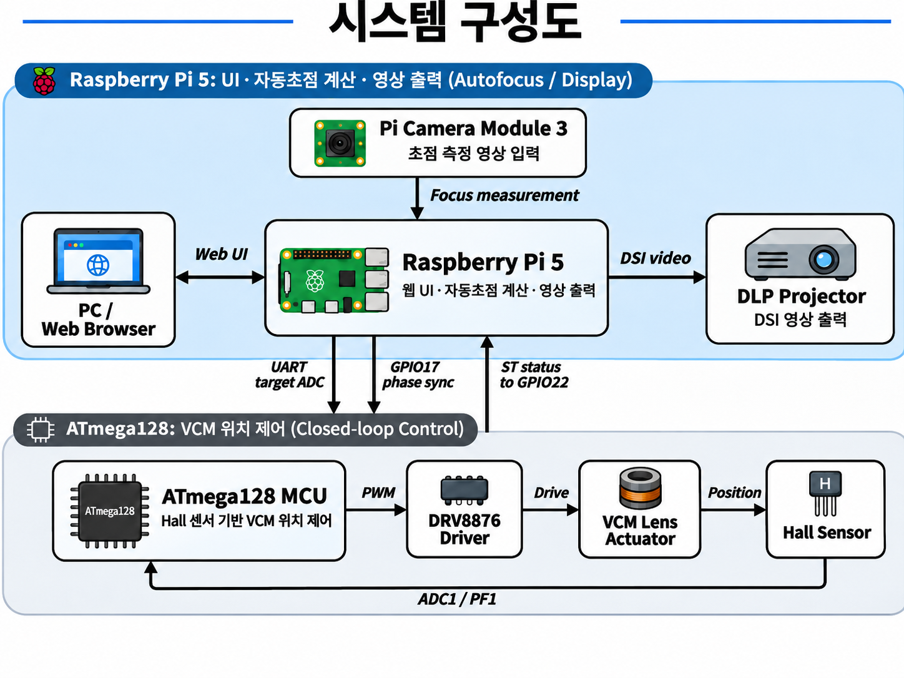

# VCM 기반 시분할 다중초점 프로젝터

**Team 갓돌 | Raspberry Pi 5 · ATmega128 · VCM · Hall Sensor · DLP**

투사면까지의 거리가 서로 다르면 한쪽에 초점을 맞췄을 때 다른 영역이 흐려집니다. 이 프로젝트는 VCM으로 렌즈 위치를 바꾸고 그에 맞춰 DLP 영상을 전환해, 서로 다른 깊이의 영역을 표현하는 다중초점 프로젝터를 구현한 작업입니다.

## 1. 저장소 구성

```text
VCM-Multifocal-Projector/
├── README.md
├── system_architecture.png
├── vcm_control_firmware.c
├── multifocal_projector_controlUI.py
├── autofocus_calibration.py
├── .gitignore
└── results/
    ├── 실험 그래프 PNG 6개
    └── 원본 측정 CSV 7개
```

ATmega128의 VCM 제어 코드, Raspberry Pi의 통합 UI, 자동초점 알고리즘과 실험 결과를 함께 정리했습니다. 그래프에 사용한 원본 기록은 `results/`에서 확인할 수 있습니다.

## 2. 시스템 구성



Raspberry Pi 5는 카메라 영상 분석과 웹 UI, DLP 영상 출력을 맡고, ATmega128은 Hall 센서 값을 받아 VCM 렌즈의 위치를 제어합니다. 두 장치는 UART로 목표 ADC를 주고받으며, GPIO17 신호로 앞뒤 초점 전환을 맞춥니다. 렌즈 위치가 정해지면 정착 상태를 확인한 뒤 다음 초점 측정으로 넘어갑니다.

- [`vcm_control_firmware.c`](vcm_control_firmware.c): Hall 피드백 기반 VCM 제어, CAL/FLIP 모드, UART·GPIO 처리
- [`multifocal_projector_controlUI.py`](multifocal_projector_controlUI.py): 웹 UI와 DLP 영상 전환, 전체 시스템 연동
- [`autofocus_calibration.py`](autofocus_calibration.py): 카메라 기반 초점 탐색과 영역별 최적 ADC 선정

Raspberry Pi 5와 DLP 모듈은 DSI 커넥터와 핀 배열이 달라 바로 연결할 수 없었습니다. 이를 해결하기 위해 별도의 인터포저 PCB를 설계·제작해 영상 출력 경로를 구성했습니다.

## 3. VCM 폐루프 위치제어

VCM은 PWM을 바꾼다고 렌즈가 항상 같은 위치에 놓이는 것은 아닙니다. 그래서 Hall 센서로 위치를 읽고, ATmega128에서 목표값과의 차이를 계속 보정하는 방식으로 제어했습니다. 영상 전환 시에는 앞뒤 초점 위치를 번갈아 추종하도록 구성했습니다.

### 앞뒤 초점 위치 반복 추종


FRONT 236 ADC와 BACK 246 ADC를 반복 전환하면서 Hall 센서의 응답을 기록했습니다. 목표값이 바뀔 때마다 실제 위치도 뒤따라 움직이며 다음 초점 위치에 접근하는 모습을 확인할 수 있습니다.

[실험 로그 CSV](results/%EC%95%9E%EB%92%A4%20%EC%B4%88%EC%A0%90%20%EC%A0%84%ED%99%98%20%EC%8B%9C%20%EB%A0%8C%EC%A6%88%20%EC%9C%84%EC%B9%98%20%EC%B6%94%EC%A2%85.csv)

### 반복 전환 후 위치오차


같은 로그에서 672개 전환 구간의 마지막 측정값을 모아 비교했습니다. **모든 구간의 종료 위치오차가 ±2 ADC 이내**였고, **평균 절대오차는 0.47 ADC**였습니다. 오차가 0 ADC인 구간이 379개로 가장 많았습니다.

[실험 로그 CSV](results/672%EA%B0%9C%20%EC%B4%88%EC%A0%90%20%EC%A0%84%ED%99%98%20%EA%B5%AC%EA%B0%84%EC%9D%98%20%EC%A2%85%EB%A3%8C%20%EC%9C%84%EC%B9%98%EC%98%A4%EC%B0%A8.csv)

### 여러 목표 위치에서의 추종


한두 위치에서만 제어가 잘되는 것은 아닌지 확인하기 위해 240~321 ADC 범위의 28개 목표 위치를 시험했습니다. 11,018개 로그 중 **98.56%가 목표 위치에서 ±3 ADC 이내**였으며, 각 목표 위치의 후반부 측정값도 대체로 목표선 가까이에 모였습니다.

[실험 로그 CSV](results/28%EA%B0%9C%20%EB%AA%A9%ED%91%9C%20%EC%9C%84%EC%B9%98%EC%9D%98%20%EC%A0%9C%EC%96%B4%20%EC%A0%95%ED%99%95%EB%8F%84.csv)

## 4. 카메라 기반 자동초점

카메라로 투사 영상을 촬영한 뒤, 화면을 네 영역(Q1~Q4)으로 나눠 초점 점수를 계산했습니다. VCM을 여러 후보 위치로 이동시키고 각 위치의 영상 선명도를 비교해 앞뒤 초점에 사용할 ADC를 정하는 방식입니다.

### 렌즈 위치별 정착 대기시간


후보 위치마다 무조건 오래 기다리기보다 정착 상태를 확인하고 촬영을 진행하도록 구성했습니다. 15개 위치에서 기록한 대기시간은 **평균 0.65초, 합계 9.75초**였습니다. 위치당 3초씩 기다리는 설정(총 45초)과 비교하면, 이 단계에서 **약 35.25초**의 대기시간을 줄일 수 있었습니다.

[측정 CSV](results/%EB%A0%8C%EC%A6%88%20%EC%9C%84%EC%B9%98%EB%B3%84%20%EC%A0%95%EC%B0%A9%20%EB%8C%80%EA%B8%B0%EC%8B%9C%EA%B0%84%20%EB%B9%84%EA%B5%90.csv)

### 렌즈 위치에 따른 초점 점수


각 ADC 위치에서 촬영한 영상의 **Raw Laplacian 점수**를 비교했습니다. 프레임별 변동을 줄이기 위해 9프레임 중앙값을 사용했고, 국소 피크의 품질까지 고려해 최적 위치를 선택했습니다. 이번 측정에서는 **Q1·Q4가 266 ADC, Q2·Q3가 275 ADC**를 선택했습니다. 영역마다 점수 크기가 달라 그래프는 각 영역 안에서 정규화했습니다.

[초점 점수 CSV](results/%EB%A0%8C%EC%A6%88%20%EC%9C%84%EC%B9%98%EB%B3%84%20%EC%9E%90%EB%8F%99%EC%B4%88%EC%A0%90%20%EC%A0%90%EC%88%98%20%EB%B9%84%EA%B5%901.csv) · [선정 결과 CSV](results/%EB%A0%8C%EC%A6%88%20%EC%9C%84%EC%B9%98%EB%B3%84%20%EC%9E%90%EB%8F%99%EC%B4%88%EC%A0%90%20%EC%A0%90%EC%88%98%20%EB%B9%84%EA%B5%902.csv)

## 5. 개발 환경

**Hardware:** Raspberry Pi 5, ATmega128, DRV8876, VCM, Hall Sensor, Pi Camera Module 3, DLP Projector, Interposer PCB  
**Software:** Raspberry Pi OS, Python, OpenCV, Picamera2, Flask, AVR C  
**Interfaces:** DSI, UART(115200 bps), GPIO17/22, PWM, ADC
